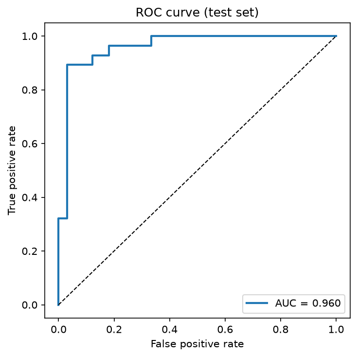
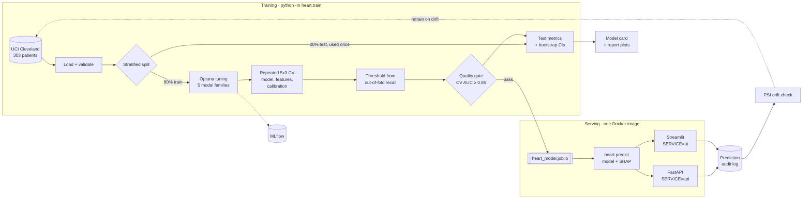

# Heart Disease Risk Predictor

[](https://github.com/Md-Faiz-Alam/heart-disease-predictor/actions/workflows/ci.yml)

[](LICENSE)

Estimates the probability of coronary artery disease from 13 routine clinical measurements. Each
prediction comes with an explanation of which measurements raised or lowered it. The project ships
as a **web app** and a **REST API** from a single Docker image.

<!-- After deploying, add:  **Live demo:** [Web app](https://...onrender.com) · [API docs](https://...onrender.com/docs) -->

> [!WARNING]
> For education and research only. This is not a medical device and must not be used for diagnosis
> or treatment decisions.


## Features

- **Risk assessment.** Probability, risk band and screening result. The decision threshold is tuned
  for 90% recall.
- **Explanations.** Per-patient SHAP values in percentage points, shown as a waterfall chart and as
  plain-language factors.
- **What-if analysis.** Adjust blood pressure, cholesterol, heart rate or ST depression and see how
  the estimate changes.
- **PDF report** for each assessment.
- **Batch screening.** Upload a CSV, get row-level validation errors, and download the scored results.
- **REST API** with OpenAPI docs, input validation, batch scoring, an optional API key and request IDs.
- **Model transparency.** A model performance page and an auto-generated
  [model card](models/MODEL_CARD.md) with confidence intervals and subgroup metrics.
- **Operations.**
  - Structured JSON logs.
  - A prediction audit log.
  - Data-drift detection.
  - Health checks.
  - A reproducible training run with a quality gate.

## Quick start

### Docker

```bash
docker compose up --build
```

| Service | URL |
|---|---|
| Web app | http://localhost:8501 |
| API docs | http://localhost:8000/docs |

Ports already in use? Override them with `API_PORT=8001 UI_PORT=8502 docker compose up`
(in PowerShell: `$env:API_PORT=8001; docker compose up`).

### Local (Python 3.13)

```bash
python -m venv .venv
source .venv/bin/activate            # Windows: .\.venv\Scripts\Activate.ps1
pip install -r requirements-dev.lock
pip install --no-deps -e .

streamlit run app.py                 # web app on :8501
uvicorn heart.api:app --reload       # API on :8000
```

A trained model is committed in `models/`, so no training is needed to run the app or the API.

## Using the API

```bash
curl -X POST "http://localhost:8000/predict?top_k=3" \
  -H "Content-Type: application/json" \
  -d '{"age":67,"sex":1,"cp":4,"trestbps":160,"chol":286,"fbs":0,"restecg":2,
       "thalach":108,"exang":1,"oldpeak":1.5,"slope":2,"ca":3,"thal":3}'
```

```json
{
  "request_id": "7e20140fb2ad4a39b93ceca879628de0",
  "probability": 0.989,
  "has_disease": true,
  "risk_band": "High",
  "threshold": 0.305,
  "base_probability": 0.483,
  "top_factors": [
    {"feature": "ca", "label": "Major vessels coloured by fluoroscopy", "display_value": "3", "shap_value": 0.243},
    {"feature": "thalach", "label": "Max heart rate achieved (bpm)", "display_value": "108", "shap_value": 0.075},
    {"feature": "cp", "label": "Chest pain type", "display_value": "Asymptomatic", "shap_value": 0.065}
  ],
  "model_name": "logistic_regression",
  "model_version": "20261125050114"
}
```

| Method | Endpoint | Description |
|---|---|---|
| `POST` | `/predict` | Score one patient. Optional `explain=false` to skip SHAP, `top_k` for the number of factors. |
| `POST` | `/predict/batch` | Score up to `HEART_MAX_BATCH_SIZE` patients (no explanations). |
| `GET` | `/model-info` | Model version, threshold, features, metrics, input JSON schema. |
| `GET` | `/health` | Liveness and model-loaded check. |

- Invalid input returns `422` with field-level errors. Examples are `cp=0`, `age=500` or an unknown
  field.
- If `HEART_API_KEY` is set, both `/predict` endpoints require an `X-API-Key` header, and return `401`
  without it.
- Every response carries an `X-Request-ID` header. If the request already sent one, it is passed
  through.

<details>
<summary><b>Input fields</b> (original UCI Cleveland encodings)</summary>

| Field | Description | Allowed values |
|---|---|---|
| `age` | Age | 18–100 years |
| `sex` | Sex | 0 female, 1 male |
| `cp` | Chest pain type | 1 typical angina, 2 atypical angina, 3 non-anginal pain, 4 asymptomatic |
| `trestbps` | Resting blood pressure | 80–220 mm Hg |
| `chol` | Serum cholesterol | 100–600 mg/dl |
| `fbs` | Fasting blood sugar > 120 mg/dl | 0 no, 1 yes |
| `restecg` | Resting ECG | 0 normal, 1 ST-T abnormality, 2 left ventricular hypertrophy |
| `thalach` | Maximum heart rate achieved | 60–220 bpm |
| `exang` | Exercise-induced angina | 0 no, 1 yes |
| `oldpeak` | ST depression, exercise vs rest | 0–7 |
| `slope` | Slope of peak exercise ST segment | 1 upsloping, 2 flat, 3 downsloping |
| `ca` | Major vessels coloured by fluoroscopy | 0–3 |
| `thal` | Thallium stress test | 3 normal, 6 fixed defect, 7 reversible defect |

The batch screening tab expects the same columns. Download the template from the app. Extra columns
such as `patient_id` are kept in the results and never logged.
</details>

## Configuration

All settings are optional. They are read from environment variables or a `.env` file
(see [`.env.example`](.env.example)).

| Variable | Default | Description |
|---|---|---|
| `SERVICE` | `api` | Container only: `api` or `ui`. |
| `PORT` | `8000` (api) / `8501` (ui) | Listening port. Hosting platforms set this automatically. |
| `WEB_CONCURRENCY` | `1` | Number of API worker processes. |
| `HEART_API_KEY` | unset | When set, required as `X-API-Key` on `/predict` endpoints. |
| `HEART_LOG_LEVEL` | `INFO` | Log level. |
| `HEART_LOG_JSON` | `true` | JSON log lines (set `false` for plain text). |
| `HEART_LOG_PREDICTIONS` | `true` | Write the prediction audit log. |
| `HEART_PREDICTION_LOG_PATH` | `logs/predictions.jsonl` | Audit log location. |
| `HEART_MAX_BATCH_SIZE` | `1000` | Maximum patients per batch request or CSV. |
| `HEART_TOP_FACTORS` | `5` | Default number of SHAP factors returned. |
| `HEART_MODEL_PATH` | `models/heart_model.joblib` | Model artifact. |

## Model

| | |
|---|---|
| **Data** | UCI Heart Disease, Cleveland subset: 303 patients, 46% positive (more than 50% narrowing on angiography) |
| **Model** | Logistic regression (L2, C ≈ 0.20, balanced classes), selected from 5 tuned families |
| **Features** | All 13 clinical measurements. Numeric features are scaled; categorical codes are one-hot encoded. |
| **Threshold** | 0.305. This is the highest threshold reaching 90% recall on out-of-fold predictions. |
| **Validation** | Repeated stratified 5×3 CV on 242 patients, plus a held-out test set of 61 patients. |

| Metric (held-out test) | Value | 95% bootstrap CI |
|---|---|---|
| ROC-AUC | 0.960 | 0.899 – 0.998 |
| Recall | 1.000 | 1.000 – 1.000 |
| Specificity | 0.667 | 0.500 – 0.829 |
| Precision | 0.718 | 0.579 – 0.854 |

Cross-validated ROC-AUC is **0.898 ± 0.041**. That is the more reliable estimate, given the small
test set.

**Limitations.**
- The data comes from a single 1988 referral cohort.
- The test-set confidence intervals are wide.
- Recall is lower for women: 0.78 vs 0.94 out-of-fold.

Full details are in the [model card](models/MODEL_CARD.md). The reasoning behind each choice is in
[docs/DESIGN.md](docs/DESIGN.md).

| ROC | Calibration | Threshold trade-off | SHAP summary |
|---|---|---|---|
|  |  |  |  |

## Architecture



## Deployment on Render

The same image runs both services, so you create **two Web Services** from this repository.
No Blueprint is needed.

1. Push the repository to GitHub.
2. In the Render dashboard, choose **New → Web Service** and connect the repository.
   Render detects the `Dockerfile`.
3. Configure the **API** service:

   | Setting | Value |
   |---|---|
   | Name | `heart-disease-api` |
   | Language | Docker |
   | Branch | `main` |
   | Instance type | Free (or higher) |
   | Environment variables | `SERVICE=api`, `HEART_LOG_PREDICTIONS=false`, optionally `HEART_API_KEY=<secret>` |
   | Health check path (Advanced) | `/health` |

4. Create a second Web Service from the same repository for the **web app**:

   | Setting | Value |
   |---|---|
   | Name | `heart-disease-app` |
   | Environment variables | `SERVICE=ui`, `HEART_LOG_PREDICTIONS=false` |
   | Health check path (Advanced) | `/_stcore/health` |

Things to know about Render:
- Render injects `PORT`, and the container listens on it. No start command is needed.
- On the free tier, the disk is ephemeral and services sleep after 15 minutes without traffic. The
  first request after that takes about a minute.
- To keep the audit log, attach a persistent disk at `/app/logs` (paid plans) and set
  `HEART_LOG_PREDICTIONS=true`.
- Memory measured locally under a 512 MB limit: the API uses about 200 MB under concurrent SHAP
  requests, and the web app about 260 MB after an assessment.

## Development

```bash
pip install -r requirements-dev.lock && pip install --no-deps -e .
pre-commit install                    # ruff, ruff-format, mypy and file checks on commit

pytest                                # full suite
pytest -m "not slow" --cov            # fast suite with coverage
ruff check . && ruff format --check . && mypy
```

### Retraining

```bash
python -m heart.train                 # about 2 minutes. Writes models/ and reports/.
python -m heart.train --trials 10 --no-track    # quick run without MLflow
mlflow ui --backend-store-uri sqlite:///mlruns/mlflow.db
```

Training refuses to save a model with cross-validated ROC-AUC below `--min-roc-auc` (default 0.85).
It regenerates [`models/MODEL_CARD.md`](models/MODEL_CARD.md), `models/metadata.json` and the plots in
`reports/`.

### Monitoring

The API and the web app append every prediction to `logs/predictions.jsonl`. Each entry holds the
clinical inputs, the output and the model version, with no identifiers. To compare logged inputs
with the training data:

```bash
python -m heart.monitoring            # PSI per feature: <0.10 stable, 0.10–0.25 moderate, >0.25 drift
python -m heart.monitoring --fail-on-drift --output reports/drift.json
```

### Updating dependencies

Edit the ranges in `pyproject.toml`, then regenerate the lockfiles:

```bash
uv pip compile pyproject.toml --extra api --python-version 3.13 --universal -o requirements.lock
uv pip compile pyproject.toml --extra api --extra train --extra dev --python-version 3.13 --universal -o requirements-dev.lock
```

If scikit-learn changes version, retrain the model. A test fails until you do.

### Continuous integration

[GitHub Actions](.github/workflows/ci.yml) runs these jobs on every push and pull request:

1. Lint and type-check.
2. Tests with coverage.
3. A from-scratch retrain behind the quality gate.
4. A Docker build that smoke-tests both services, with `PORT` injected the way Render does.

A [weekly workflow](.github/workflows/drift.yml) runs the drift check.

## Project structure

```
├── app.py                    # Streamlit entry point
├── src/heart/
│   ├── api.py                # FastAPI service
│   ├── predict.py            # inference + SHAP (shared by API and UI)
│   ├── schemas.py            # request/response models, CSV validation
│   ├── train.py              # training run
│   ├── tuning.py             # model families and Optuna search spaces
│   ├── evaluate.py           # metrics, threshold, CIs, plots, model card
│   ├── features.py           # preprocessing pipeline
│   ├── data.py               # data loading and validation
│   ├── monitoring.py         # drift report
│   ├── observability.py      # JSON logging, prediction audit log
│   ├── report.py             # PDF report
│   ├── serve.py              # container entrypoint (SERVICE / PORT)
│   ├── settings.py           # environment configuration
│   ├── tracking.py           # MLflow integration
│   ├── config.py             # paths, feature definitions, constants
│   └── ui/                   # Streamlit components and tabs
├── tests/
├── models/                   # trained model, metadata, model card
├── reports/                  # evaluation plots
├── data/raw/                 # UCI Cleveland dataset
├── notebooks/                # exploratory data analysis
├── docs/DESIGN.md            # design notes
├── Dockerfile
├── docker-compose.yml
└── pyproject.toml
```

## License

The code is released under the [MIT License](LICENSE). The dataset in `data/raw/` keeps its own license,
[CC BY 4.0](https://archive.ics.uci.edu/dataset/45/heart+disease): Janosi, A., Steinbrunn, W.,
Pfisterer, M. & Detrano, R. (1988). *Heart Disease*. UCI Machine Learning Repository.
