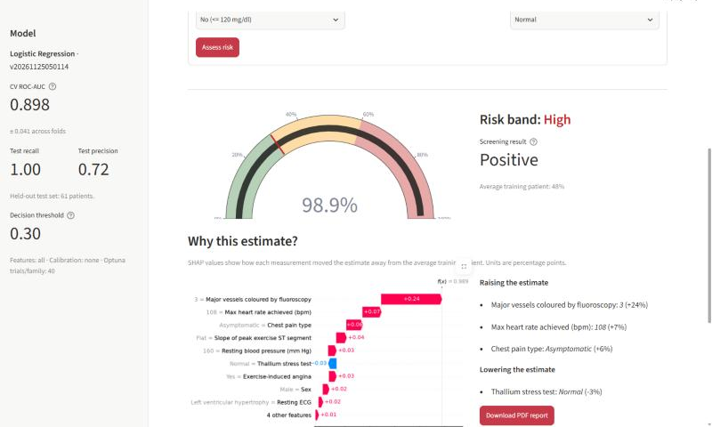
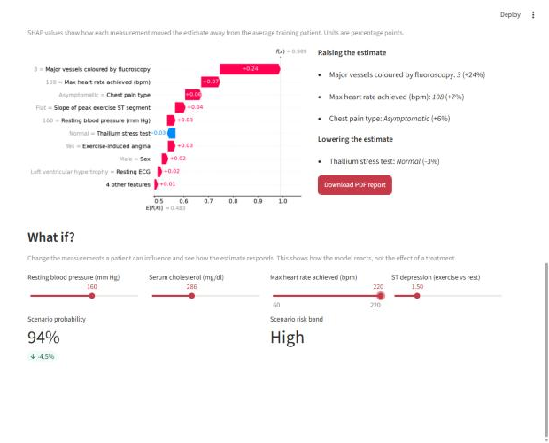
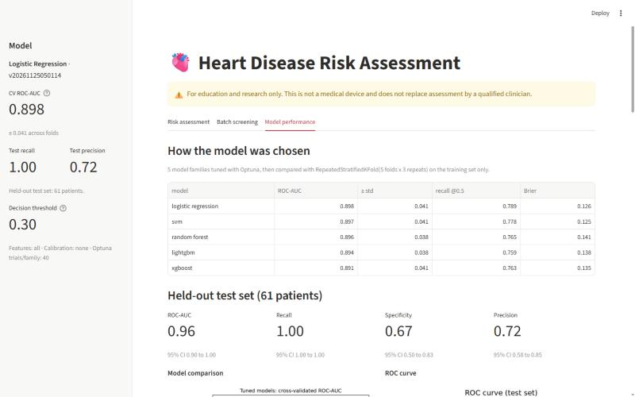
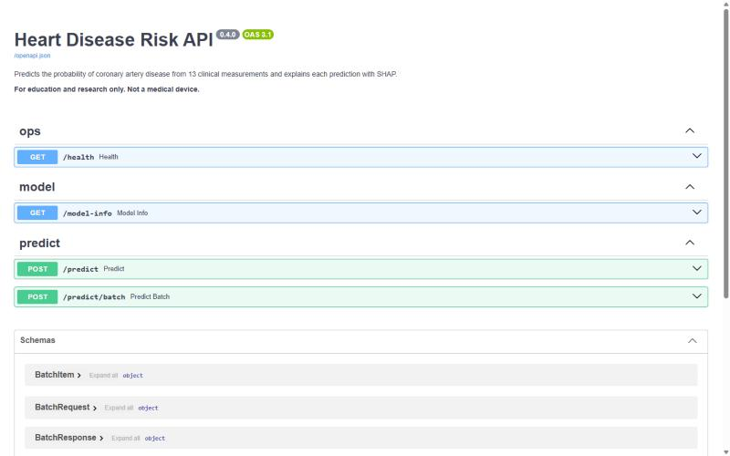
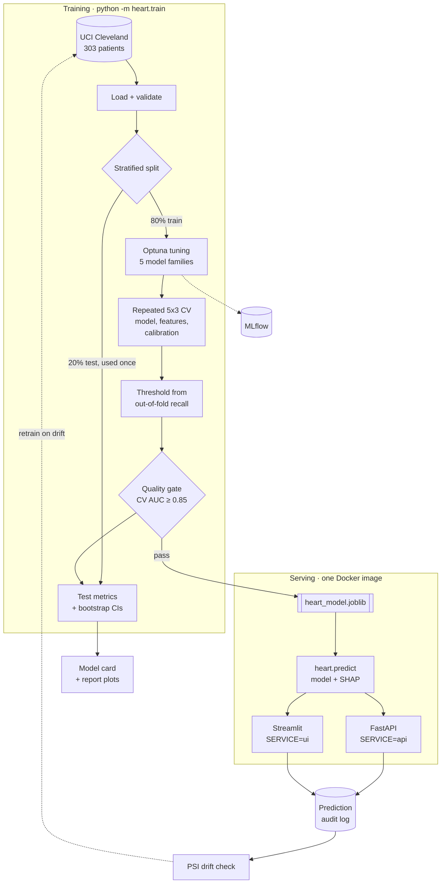
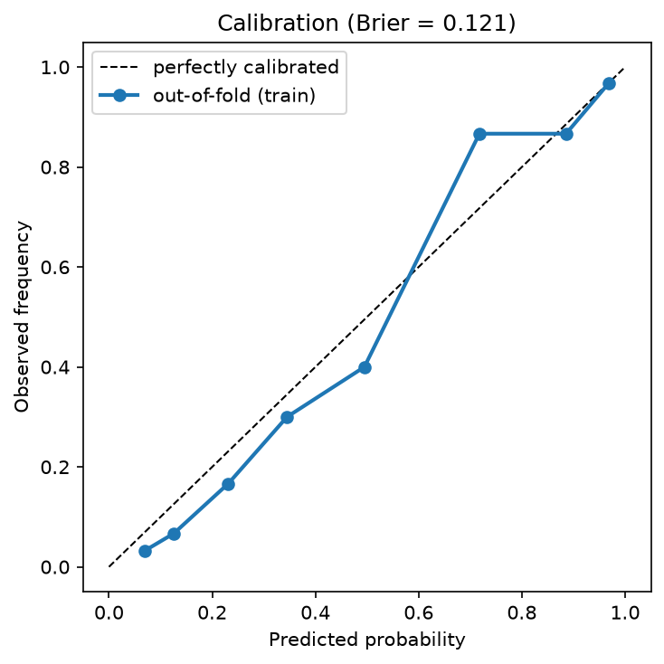
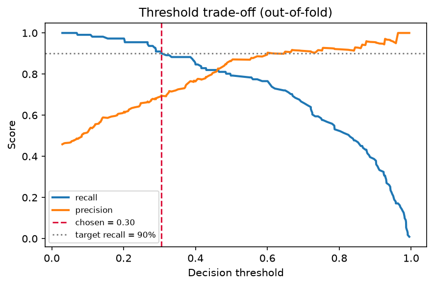
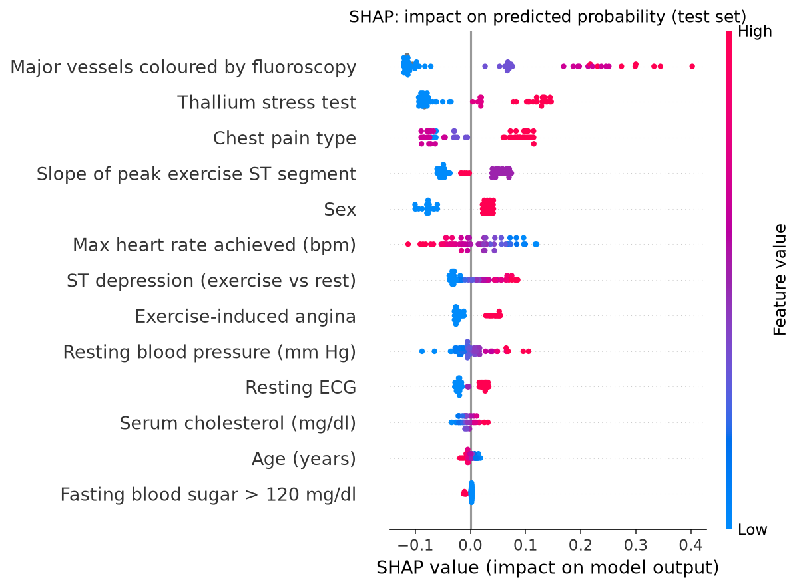

<div align="center">

# 🫀 Heart Disease Risk Predictor

**Explainable cardiovascular risk scoring, served as a web app and a REST API.**

[](https://heart-disease-app-c427.onrender.com)
[](https://heart-disease-api-wipd.onrender.com/docs)
[](https://github.com/Md-Faiz-Alam/heart-disease-predictor/actions/workflows/ci.yml)
[](pyproject.toml)
[](Dockerfile)
[](LICENSE)

[**Live demo**](https://heart-disease-app-c427.onrender.com) ·
[**API docs**](https://heart-disease-api-wipd.onrender.com/docs) ·
[**Model card**](models/MODEL_CARD.md) ·
[**Design notes**](docs/DESIGN.md) ·
[**Changelog**](CHANGELOG.md)



</div>

> [!WARNING]
> **Research and education use only.** This software is not a medical device. It has not been
> clinically validated and must not be used for diagnosis or treatment decisions.

> [!NOTE]
> The demo runs on Render's free tier. After a period of inactivity, the first request can take up to
> a minute while the service wakes up.

---

## Table of contents

- [Overview](#overview)
- [Features](#features)
- [Tech stack](#tech-stack)
- [Architecture](#architecture)
- [Getting started](#getting-started)
- [Usage](#usage)
- [Configuration](#configuration)
- [Model](#model)
- [Development](#development)
- [Deployment](#deployment)
- [Project structure](#project-structure)
- [Roadmap](#roadmap)
- [Contributing](#contributing)
- [Security](#security)
- [License](#license)
- [Acknowledgments](#acknowledgments)

## Overview

The predictor estimates the probability of coronary artery disease from 13 routine clinical
measurements. It covers the full lifecycle:

- validated data ingestion;
- a reproducible training run with hyper-parameter tuning, calibration checks and a decision
  threshold tuned for screening;
- an auto-generated model card;
- a REST API and a Streamlit app that share one inference module;
- structured logging, a prediction audit log and data-drift monitoring;
- CI that blocks any model below a quality gate.

Every prediction is explained per patient with SHAP, in percentage points of risk. For example:
*"Major vessels = 3 raised the estimate by 24 points."*

## Features

| | |
|---|---|
| 🎯 **Risk assessment** | Probability, risk band (Low / Moderate / High) and screening result. The threshold is tuned for 90% recall. |
| 🔍 **Explainability** | SHAP waterfall per patient, plain-language contributing factors, and global SHAP summary plots. |
| 🎛️ **What-if analysis** | Adjust blood pressure, cholesterol, max heart rate or ST depression and see the estimate respond. |
| 📄 **PDF reports** | One-page downloadable summary of each assessment. |
| 📊 **Batch screening** | CSV upload with row-level validation, scored results and a probability histogram. |
| 🔌 **REST API** | OpenAPI docs, Pydantic validation, batch endpoint, optional API key, request IDs. |
| 📈 **Model transparency** | In-app performance dashboard, bootstrap confidence intervals, subgroup metrics, model card. |
| 🛡️ **Operations** | JSON logs, prediction audit log, PSI drift detection, health checks, quality-gated retraining. |

<table>
  <tr>
    <td align="center"><br><sub>What-if analysis</sub></td>
    <td align="center"><br><sub>Model performance</sub></td>
    <td align="center"><br><sub>Interactive API docs</sub></td>
  </tr>
</table>

## Tech stack

| Area | Tools |
|---|---|
| Machine learning | scikit-learn, XGBoost, LightGBM, Optuna, SHAP |
| Serving | FastAPI, Uvicorn, Streamlit, Pydantic |
| Experiment tracking | MLflow |
| Reporting | Matplotlib, Plotly, fpdf2 |
| Quality | pytest, ruff, mypy, pre-commit |
| Packaging and delivery | Docker, docker compose, uv lockfiles, GitHub Actions, Render |

## Architecture



- **One artifact.** Preprocessing, the model, the decision threshold and the SHAP background sample
  are saved together, so training and serving cannot drift apart.
- **One inference module.** `heart.predict` serves the API, the web app and batch scoring, so all
  of them return identical results.
- **One image.** The same container runs either service, selected by `SERVICE=api|ui`. It honours the
  `PORT` that the host injects.

See [docs/DESIGN.md](docs/DESIGN.md) for the reasoning behind each decision.

## Getting started

### Prerequisites

- **Docker** 24+ *or* **Python 3.13**
- Git

A trained model is committed in [`models/`](models), so no training is needed to run the services.

### Run with Docker (recommended)

```bash
git clone https://github.com/Md-Faiz-Alam/heart-disease-predictor.git
cd heart-disease-predictor
docker compose up --build
```

| Service | URL |
|---|---|
| Web app | http://localhost:8501 |
| API docs | http://localhost:8000/docs |

Ports already in use? Run `API_PORT=8001 UI_PORT=8502 docker compose up`
(in PowerShell: `$env:API_PORT=8001; $env:UI_PORT=8502; docker compose up`).

### Run locally

```bash
python -m venv .venv
source .venv/bin/activate              # Windows: .\.venv\Scripts\Activate.ps1
pip install -r requirements-dev.lock
pip install --no-deps -e .

streamlit run app.py                   # web app  → http://localhost:8501
uvicorn heart.api:app --reload         # REST API → http://localhost:8000/docs
```

## Usage

### Web app

1. Open the app and choose an example patient, or enter values yourself.
2. Click **Assess risk** to see the probability, risk band and SHAP explanation.
3. Move the **What if?** sliders to explore scenarios, then download the **PDF report**.
4. Use **Batch screening** to score a CSV. A template is available in the tab.
5. Open **Model performance** for validation metrics, plots and the full model card.

### REST API

**cURL**
```bash
curl -X POST "https://heart-disease-api-wipd.onrender.com/predict?top_k=3" \
  -H "Content-Type: application/json" \
  -H "X-API-Key: $HEART_API_KEY" \
  -d '{"age":67,"sex":1,"cp":4,"trestbps":160,"chol":286,"fbs":0,"restecg":2,
       "thalach":108,"exang":1,"oldpeak":1.5,"slope":2,"ca":3,"thal":3}'
```

**Python**
```python
import requests

patient = {"age": 67, "sex": 1, "cp": 4, "trestbps": 160, "chol": 286, "fbs": 0, "restecg": 2,
           "thalach": 108, "exang": 1, "oldpeak": 1.5, "slope": 2, "ca": 3, "thal": 3}

response = requests.post(
    "https://heart-disease-api-wipd.onrender.com/predict",
    params={"top_k": 3},
    headers={"X-API-Key": "<your-key>"},
    json=patient,
    timeout=60,
)
response.raise_for_status()
print(response.json()["probability"])
```

**Response**
```json
{
  "request_id": "7e20140fb2ad4a39b93ceca879628de0",
  "probability": 0.989,
  "has_disease": true,
  "risk_band": "High",
  "threshold": 0.305,
  "base_probability": 0.483,
  "top_factors": [
    {"feature": "ca", "label": "Major vessels coloured by fluoroscopy", "value": 3.0, "display_value": "3", "shap_value": 0.243},
    {"feature": "thalach", "label": "Max heart rate achieved (bpm)", "value": 108.0, "display_value": "108", "shap_value": 0.075},
    {"feature": "cp", "label": "Chest pain type", "value": 4.0, "display_value": "Asymptomatic", "shap_value": 0.065}
  ],
  "model_name": "logistic_regression",
  "model_version": "20261125050114"
}
```

#### Endpoints

| Method | Path | Auth | Description |
|---|---|---|---|
| `POST` | `/predict` | API key¹ | Score one patient. Query parameters: `explain` (default `true`) and `top_k` (1–13). |
| `POST` | `/predict/batch` | API key¹ | Score up to `HEART_MAX_BATCH_SIZE` patients, without explanations. |
| `GET` | `/model-info` | — | Model version, threshold, features, metrics, input JSON schema. |
| `GET` | `/health` | — | Liveness and model-loaded check. |
| `GET` | `/docs` | — | Interactive OpenAPI documentation. |

¹ Required only when `HEART_API_KEY` is configured.

#### Status codes

| Code | Meaning |
|---|---|
| `200` | Success |
| `401` | Missing or invalid `X-API-Key` |
| `413` | Batch larger than `HEART_MAX_BATCH_SIZE` |
| `422` | Validation error with field-level details, e.g. `cp=0`, `age=500` or an unknown field |
| `503` | Model not loaded |

Every response includes an `X-Request-ID` header. If the client sends one, it is passed through.

<details>
<summary><b>Input schema</b> (original UCI Cleveland encodings)</summary>

| Field | Description | Allowed values |
|---|---|---|
| `age` | Age | 18–100 years |
| `sex` | Sex | 0 female, 1 male |
| `cp` | Chest pain type | 1 typical angina, 2 atypical angina, 3 non-anginal pain, 4 asymptomatic |
| `trestbps` | Resting blood pressure | 80–220 mm Hg |
| `chol` | Serum cholesterol | 100–600 mg/dl |
| `fbs` | Fasting blood sugar > 120 mg/dl | 0 no, 1 yes |
| `restecg` | Resting ECG | 0 normal, 1 ST-T abnormality, 2 left ventricular hypertrophy |
| `thalach` | Maximum heart rate achieved | 60–220 bpm |
| `exang` | Exercise-induced angina | 0 no, 1 yes |
| `oldpeak` | ST depression, exercise vs rest | 0–7 |
| `slope` | Slope of peak exercise ST segment | 1 upsloping, 2 flat, 3 downsloping |
| `ca` | Major vessels coloured by fluoroscopy | 0–3 |
| `thal` | Thallium stress test | 3 normal, 6 fixed defect, 7 reversible defect |

Batch CSVs use the same columns. Extra columns such as `patient_id` are kept in the results and are
never logged.
</details>

## Configuration

All settings are optional. They are read from environment variables or a `.env` file
(see [`.env.example`](.env.example)).

| Variable | Default | Description |
|---|---|---|
| `SERVICE` | `api` | Container role: `api` or `ui`. |
| `PORT` | `8000` (api) / `8501` (ui) | Listening port. Hosting platforms set this automatically. |
| `WEB_CONCURRENCY` | `1` | Number of API worker processes. |
| `HEART_API_KEY` | *unset* | When set, required as `X-API-Key` on `/predict` endpoints. |
| `HEART_LOG_LEVEL` | `INFO` | Log level. |
| `HEART_LOG_JSON` | `true` | Emit JSON log lines. Set `false` for plain text. |
| `HEART_LOG_PREDICTIONS` | `true` | Write the prediction audit log. |
| `HEART_PREDICTION_LOG_PATH` | `logs/predictions.jsonl` | Audit log location. |
| `HEART_MAX_BATCH_SIZE` | `1000` | Maximum patients per batch request or CSV. |
| `HEART_TOP_FACTORS` | `5` | Default number of SHAP factors returned. |
| `HEART_MODEL_PATH` | `models/heart_model.joblib` | Model artifact path. |

## Model

| | |
|---|---|
| **Dataset** | UCI Heart Disease, Cleveland subset: 303 patients, 46% positive (more than 50% narrowing on angiography) |
| **Algorithm** | Logistic regression (L2, C ≈ 0.20, balanced class weights), selected from 5 Optuna-tuned families |
| **Features** | All 13 measurements. Numeric features are standardised; categorical codes are one-hot encoded; missing values are imputed inside the pipeline. |
| **Decision threshold** | 0.305, the highest threshold that reaches 90% recall on out-of-fold predictions |
| **Validation** | Repeated stratified 5×3 CV on 242 patients, plus a held-out test set of 61 patients scored once |

| Metric | Cross-validation | Held-out test | 95% bootstrap CI (test) |
|---|---|---|---|
| ROC-AUC | 0.898 ± 0.041 | 0.960 | 0.899 – 0.998 |
| Recall | — | 1.000 | 1.000 – 1.000 |
| Specificity | — | 0.667 | 0.500 – 0.829 |
| Precision | — | 0.718 | 0.579 – 0.854 |

<table>
  <tr>
    <td align="center"><br><sub>ROC</sub></td>
    <td align="center"><br><sub>Calibration</sub></td>
    <td align="center"><br><sub>Threshold trade-off</sub></td>
    <td align="center"><br><sub>SHAP summary</sub></td>
  </tr>
</table>

### Limitations

- **Data:** a single 1988 referral cohort (Cleveland Clinic). It is not representative of a general
  screening population.
- **Uncertainty:** the 61-patient test set gives wide confidence intervals. The CV estimate is the
  more reliable figure.
- **Fairness:** out-of-fold recall is lower for women (0.78) than for men (0.94).
- **Interpretation:** what-if results show how the model responds, not causal treatment effects.

The [model card](models/MODEL_CARD.md) has the full details, including subgroup metrics and the
candidate model comparison.

## Development

### Setup

```bash
pip install -r requirements-dev.lock && pip install --no-deps -e .
pre-commit install            # ruff, ruff-format, mypy and file checks on every commit
```

### Quality checks

```bash
pytest                        # full test suite
pytest -m "not slow" --cov    # fast suite with coverage
ruff check . && ruff format --check . && mypy
```

The tests cover:
- data validation and input schemas;
- pipeline behaviour and SHAP additivity;
- threshold selection and bootstrap CIs;
- the API (`TestClient`) and the Streamlit app (`AppTest`);
- PDF generation and drift detection;
- quality gates on the committed model;
- end-to-end training runs.

### Training

```bash
python -m heart.train                         # full run, about 2 minutes
python -m heart.train --trials 10 --no-track  # quick run without MLflow
mlflow ui --backend-store-uri sqlite:///mlruns/mlflow.db
```

The training run:
- tunes, compares and selects the model;
- checks calibration and sets the decision threshold;
- evaluates once on the test set;
- regenerates [`models/MODEL_CARD.md`](models/MODEL_CARD.md), `models/metadata.json` and the plots
  in `reports/`.

It refuses to save a model whose cross-validated ROC-AUC is below `--min-roc-auc` (default 0.85).

### Monitoring

The API and the web app append each prediction to the audit log. Each entry holds the clinical
inputs, the output and the model version, with no identifiers. To compare live inputs with the
training data:

```bash
python -m heart.monitoring                               # PSI per feature
python -m heart.monitoring --fail-on-drift --output reports/drift.json
```

PSI below 0.10 is stable, 0.10–0.25 is a moderate shift, and above 0.25 is significant drift.

### Dependencies

Version ranges live in [`pyproject.toml`](pyproject.toml). Exact pins are generated with
[uv](https://github.com/astral-sh/uv):

```bash
uv pip compile pyproject.toml --extra api --python-version 3.13 --universal -o requirements.lock
uv pip compile pyproject.toml --extra api --extra train --extra dev --python-version 3.13 --universal -o requirements-dev.lock
```

If scikit-learn changes version, retrain the model. A quality test fails until the artifact matches.

### Continuous integration

[GitHub Actions](.github/workflows/ci.yml) runs on every push and pull request:

| Job | What it does |
|---|---|
| Lint & type-check | `ruff check`, `ruff format --check`, `mypy` |
| Tests | Full pytest suite with coverage report |
| Retrain + quality gate | Trains from scratch and fails if CV ROC-AUC is below 0.85 |
| Docker | Builds the image, starts both services with an injected `PORT`, smoke-tests `/predict` and the UI health check |

A [scheduled workflow](.github/workflows/drift.yml) runs the drift check weekly.

## Deployment

The project is deployed on **Render** as two Web Services built from the same Dockerfile.

| Setting | API service | Web app service |
|---|---|---|
| Language | Docker | Docker |
| Environment | `SERVICE=api`, `HEART_LOG_PREDICTIONS=false`, `HEART_API_KEY=<secret>` | `SERVICE=ui`, `HEART_LOG_PREDICTIONS=false` |
| Health check path | `/health` | `/_stcore/health` |

- Render injects `PORT`, so no start command is needed.
- Both services fit within the 512 MB free tier. Measured locally: about 200 MB for the API under
  concurrent load, and about 260 MB for the web app.
- To keep the audit log across restarts, attach a persistent disk at `/app/logs` and set
  `HEART_LOG_PREDICTIONS=true`.
- The image works the same way on any container platform that injects `PORT`.

## Project structure

```
heart-disease-predictor/
├── app.py                    # Streamlit entry point
├── src/heart/
│   ├── api.py                # FastAPI service
│   ├── predict.py            # inference + SHAP (shared by API and UI)
│   ├── schemas.py            # request/response models, CSV validation
│   ├── train.py              # training run
│   ├── tuning.py             # model families and Optuna search spaces
│   ├── evaluate.py           # metrics, threshold, CIs, plots, model card
│   ├── features.py           # preprocessing pipeline
│   ├── data.py               # data loading and validation
│   ├── monitoring.py         # PSI drift report
│   ├── observability.py      # JSON logging, prediction audit log
│   ├── report.py             # PDF report
│   ├── serve.py              # container entrypoint (SERVICE / PORT)
│   ├── settings.py           # environment configuration
│   ├── tracking.py           # MLflow integration
│   ├── config.py             # paths, feature definitions, constants
│   └── ui/                   # Streamlit components and tabs
├── tests/                    # pytest suite
├── models/                   # trained model, metadata, model card
├── reports/                  # evaluation plots
├── data/raw/                 # UCI Cleveland dataset
├── notebooks/                # exploratory data analysis
├── docs/DESIGN.md            # design notes
├── .github/workflows/        # CI and drift workflows
├── Dockerfile
├── docker-compose.yml
├── pyproject.toml
└── requirements*.lock        # pinned dependencies
```

## Roadmap

- [ ] Nested cross-validation for an unbiased estimate of performance after model selection
- [ ] Persistent audit-log storage (database or object storage) instead of local files
- [ ] Rate limiting and per-client API keys
- [ ] Automated retraining when drift is detected, with model registry promotion
- [ ] Group-aware thresholds to close the recall gap for female patients
- [ ] External validation on the Hungarian, Swiss and VA subsets of the UCI data

## Contributing

Contributions are welcome. To contribute:

1. Fork the repository and create a feature branch.
2. Install the dev environment and the pre-commit hooks (see [Development](#development)).
3. Add or update tests for your change, and make sure `pytest`, `ruff` and `mypy` pass.
4. Open a pull request describing the change and its motivation.

Please report bugs and feature requests through
[GitHub Issues](https://github.com/Md-Faiz-Alam/heart-disease-predictor/issues).

## Security

- The audit log records clinical measurements and outputs only. It never records names, IDs or other
  identifiers. Do not send identifying data to the API.
- Set `HEART_API_KEY` on any publicly reachable API. Keep secrets in environment variables, not in
  the repository.
- To report a vulnerability, please open a private
  [security advisory](https://github.com/Md-Faiz-Alam/heart-disease-predictor/security/advisories/new)
  instead of a public issue.

## License

The code is released under the [MIT License](LICENSE).

The dataset in `data/raw/` is not covered by the MIT License. It is distributed under
[CC BY 4.0](https://archive.ics.uci.edu/dataset/45/heart+disease) by the UCI Machine Learning
Repository.

## Acknowledgments

- Janosi, A., Steinbrunn, W., Pfisterer, M. & Detrano, R. (1988). *Heart Disease* [Dataset].
  UCI Machine Learning Repository. https://doi.org/10.24432/C52P4X
- [SHAP](https://github.com/shap/shap), [scikit-learn](https://scikit-learn.org),
  [Optuna](https://optuna.org), [FastAPI](https://fastapi.tiangolo.com) and
  [Streamlit](https://streamlit.io).

<div align="center">
<sub>Built by <a href="https://github.com/Md-Faiz-Alam">Md Faiz Alam</a></sub>
</div>
